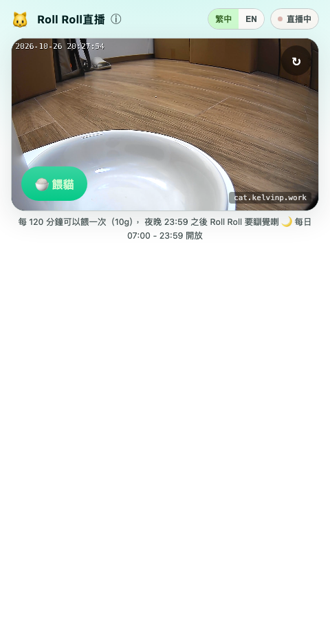
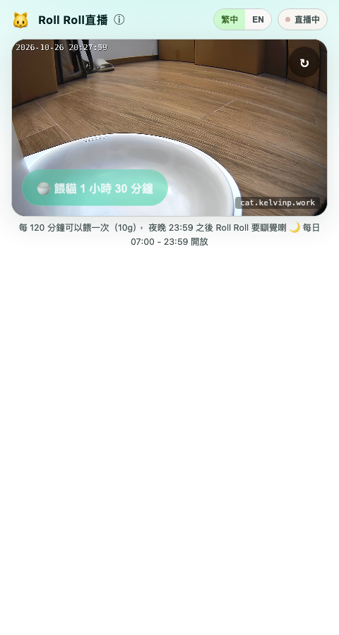
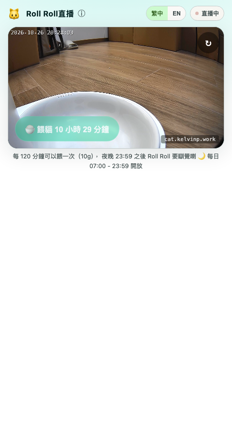
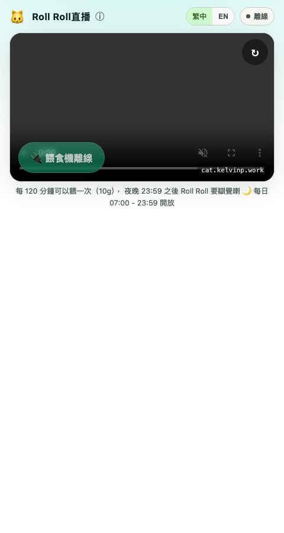
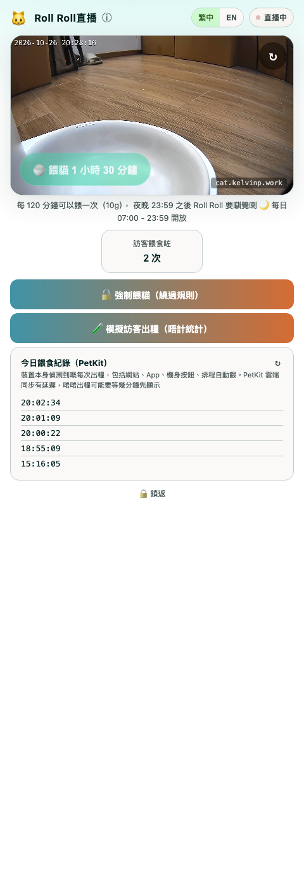

# 🐱 CatCam

A public **"feed my cat"** web app. Viewers open a link, watch a live stream of
the cat, and press a button to dispense a portion of food — subject to sensible
rules (shared cooldown, open hours, anti-spam). The button ultimately triggers a
real smart feeder through Home Assistant. A hidden admin channel (tap the logo
5×) lets the owner bypass those rules with an HMAC-signed request.

```
Viewer's browser
      │
      ├────────────────────────────────────────────┐
      ▼                                             ▼
SvelteKit frontend  ──►  FastAPI backend  ──►  Home Assistant REST API  ──►  🍚 feeder
   (static SPA)          (rules + state)        (text.*_manual_feed)
      │
      ▼
go2rtc (WebSocket + MSE)  ──►  Home Assistant WHEP  ──►  📷 PetKit camera
```

## Why I built it

I wanted a small but complete full-stack project on real hardware: a camera and
a smart pet feeder at home, exposed safely to the public internet. It turned
into a nice exercise in API design, concurrency, rate limiting, and keeping
secrets on the server side — never in the browser.

## Repository layout

| Folder             | What it is                                                        |
| ------------------ | ----------------------------------------------------------------- |
| [`catcam-backend`](./catcam-backend)   | Python + FastAPI service. Enforces feeding rules and calls Home Assistant. Keeps the HA token server-side. |
| [`catcam-frontend`](./catcam-frontend) | SvelteKit static SPA (繁中/EN toggle). Live stream (go2rtc, WebSocket+MSE), status, feed button, and a hidden admin channel. |

Each folder has its own README with setup and deployment details.

## Feeding rules

- **Link-only** — no login required.
- **Shared cooldown** — 120 minutes between feeds, across all visitors.
- **Open hours** — 07:00–23:59 (Asia/Hong_Kong).
- **Fixed portion** — one standard amount per feed.
- **Per-IP anti-spam** — stops a single client hammering the endpoint (separate from the feeding quota).
- State (`last_fed_at`) is persisted in **SQLite**, so restarts keep the limits.

## Screenshots

The feed button reflects exactly one state at a time — `GET /status` returns
`can_feed` + a `reason`, and the frontend renders accordingly:

| State | `reason` | What the visitor sees |
| ----- | -------- | ---------------------- |
| Ready to feed | `ok` |  |
| Cooldown running | `cooldown` |  |
| Outside open hours | `outside_hours` |  |
| Feeder (Home Assistant) unreachable | `ha_offline` |  |

`ha_offline` is detected server-side by a background poll against Home
Assistant (independent of any feed attempt) — the button disables itself
within ~15s of HA going down, instead of waiting for a visitor to hit it and
get a 502.

All screenshots above show a live camera frame — captured with
[`docs/screenshots/camera-live-reference.png`](docs/screenshots/camera-live-reference.png)
kept as the canonical "online" reference frame, so any future re-capture of
these screenshots reuses the same scene instead of whatever happens to be in
frame at capture time.

The hidden admin channel (tap the logo 5×, enter the password) unlocks a
force-feed button that bypasses all the rules above, a simulate-visitor test
feed for exercising the dispense pipeline without affecting the public
cooldown or stats, and today's PetKit-side dispense history:



## Tech stack

- **Backend:** Python, FastAPI, Uvicorn, httpx, SQLite
- **Frontend:** SvelteKit (static adapter), Vite
- **Infra:** Caddy (static serving + reverse proxy), Cloudflare Tunnel, Home
  Assistant, go2rtc (WHEP → WebSocket+MSE relay for the live camera)

## Quick start

Run the two parts separately during development:

```bash
# Backend — see catcam-backend/README.md
cd catcam-backend
python3 -m venv .venv && .venv/bin/pip install -r requirements.txt
cp .env.example .env        # then set HA_TOKEN
.venv/bin/uvicorn app.main:app --host 127.0.0.1 --port 8080

# Frontend — see catcam-frontend/README.md
cd catcam-frontend
cp .env.example .env
npm install
npm run dev                 # http://localhost:5173
```

## Configuration & secrets

Both parts are configured via `.env` files. A `.env.example` template is
provided in each folder — copy it to `.env` and fill in your own values. The
real `.env` files are **git-ignored and never committed**; in particular the
Home Assistant long-lived access token lives only in the backend's `.env`.

