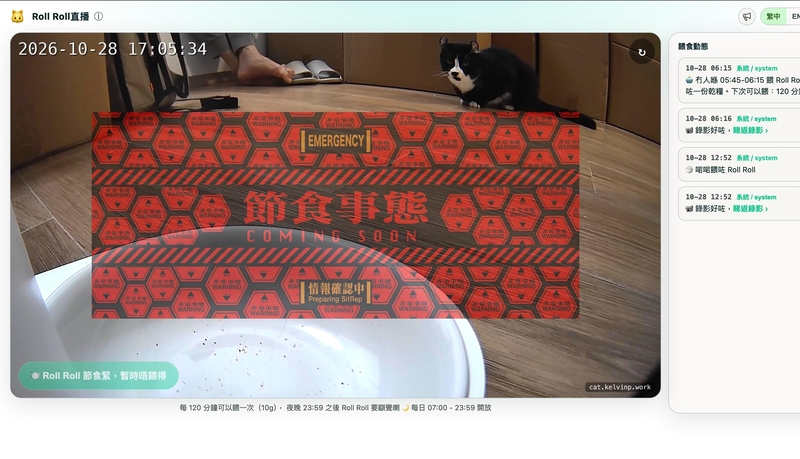

# 🐱 CatCam

一個公開的**網上餵貓**應用程式。訪客開啟連結後，可以觀看貓咪直播並按掣出一份
乾糧；系統會執行共用 cooldown、開放時間及防洗版等規則。餵食按鈕最終經由
Home Assistant 控制真實智能餵食機。主人可連按標誌 5 次開啟隱藏 Admin 通道，
再以 HMAC 簽署請求繞過公開規則。

```
訪客瀏覽器
      │
      ├────────────────────────────────────────────┐
      ▼                                             ▼
SvelteKit 前端  ──►  FastAPI 後端  ──►  Home Assistant REST API  ──►  🍚 餵食機
  （靜態 SPA）       （規則及狀態）        (text.*_manual_feed)
      │
      ▼
go2rtc (WebSocket + MSE)  ──►  Home Assistant WHEP  ──►  📷 PetKit 相機
```

### 隔離 Preview 環境

新功能先部署到 `cat-preview.kelvinp.work` 驗收，不直接改動正式
`cat.kelvinp.work`。Preview 使用 port `8081`、獨立
`/opt/catcam-preview/data/catcam-preview.db`，並以 `PREVIEW_MODE=true` 運行。
它不載入 HA 或 Telegram 憑證，不啟動 recorder、buffer、streamwatch、highlights
或 feedwatch；所有訪客／Admin／自動餵食都只寫入 Preview DB。畫面頂部會固定顯示
「模擬環境」警告。直播可共用唯讀 go2rtc 畫面，但任何 Preview endpoint 都沒有
控制真實餵食機的路徑。

## 製作原因

我想以家中的相機及智能餵食機，製作一個小型但完整、真正連接硬件的全端專案，
並安全地開放到互聯網。這個專案亦讓我實際練習 API 設計、並行處理、速率限制，
以及只在伺服器端保存秘密資料、不把金鑰放進瀏覽器等做法。

## 專案結構

| 資料夾 | 用途 |
| ------------------ | ----------------------------------------------------------------- |
| [`catcam-backend`](./catcam-backend) | Python + FastAPI 服務。執行餵食規則、呼叫 Home Assistant，並把 HA token 留在伺服器端。 |
| [`catcam-frontend`](./catcam-frontend) | SvelteKit 靜態 SPA（繁中／英文切換）。提供 go2rtc WebSocket + MSE 直播、狀態、餵食按鈕及隱藏 Admin 通道。 |

兩個資料夾各有自己的 README，詳細說明安裝及部署方法。

## 餵食規則

- **憑連結使用**：毋須登入。
- **共用 cooldown**：Admin 可在秘密通道設定 120–240 分鐘；所有訪客共用同一值。
- **開放時間**：香港時間 07:00–23:59。
- **固定份量**：每次出一份標準份量。
- **每個 IP 防洗版**：阻止單一用戶短時間內重複呼叫 endpoint，與餵食配額分開計算。
- `last_fed_at` 與 Admin 選擇的 `cooldown_minutes` 會保存至 **SQLite**，重啟服務後
  仍會保留限制。

### API 對照與 `/feed` 後端防線

| 功能 | API | 主要規則 |
| --- | --- | --- |
| 訪客餵食 | `POST /feed` | 受開放時間及目前 cooldown 限制 |
| Admin 強制餵食 | `POST /admin/feed` | 繞過限制；成功後重設目前 cooldown |
| Admin 模擬出糧 | `POST /admin/feed-test` | 繞過限制；不改 cooldown |
| Admin 餵罐罐 | `POST /admin/wet-food` | 繞過限制；重設目前 cooldown，但不出糧、不錄影 |
| 設定 Cooldown | `POST /admin/cooldown` | Admin 簽署；設定 120–240 分鐘並立即重新計算倒數 |
| 設定公告 | `POST /admin/announcement` | Admin 簽署 |
| 開啟禁食 | `POST /admin/fasting` | Admin 簽署 |
| 解除禁食 | `POST /admin/fasting/clear` | Admin 簽署 |
| 設定自動餵食 | `POST /admin/auto-feed` | Admin 簽署；同日時段，結束最遲 22:59 |
| 今日 PetKit 紀錄 | `GET /admin/history` | Admin 簽署 |

直接呼叫公開的 `POST /feed` 亦不能繞過開放時間或 cooldown，因為後端會在
呼叫 Home Assistant 前重新檢查：

```text
任何人直接 POST /feed
          │
          ▼
每個 IP：60 秒最多 5 次
          │
          ▼
取得資料庫 last_fed_at
          │
          ▼
按香港時間重新檢查
   ┌──────┴────────┐
時間外             cooldown 中
HTTP 403            HTTP 429
不出糧              不出糧
          │
          ▼
兩項都通過才呼叫 Home Assistant 出糧
```

Admin 在公開餵食時間外記錄餵罐罐後，系統會同時考慮「目前 cooldown 結束」及
「公開餵食時段開放」；公開按鈕以兩者中較遲的時間作為倒數終點。以下以 120 分鐘
設定為例：

| 餵罐罐時間 | 120 分鐘後 | 公開餵食最早時間 | 按鈕大約顯示 |
| --- | --- | --- | --- |
| 凌晨 01:00 | 03:00 | 07:00 | `🍚 餵貓 6 小時 0 分鐘` |
| 凌晨 05:30 | 07:30 | 07:30 | `🍚 餵貓 2 小時 0 分鐘` |
| 早上 06:30 | 08:30 | 08:30 | `🍚 餵貓 2 小時 0 分鐘` |

## 畫面截圖

餵食按鈕每次只會顯示一種狀態。`GET /status` 會回傳 `can_feed` 及 `reason`，
前端再按結果顯示對應畫面：

| 狀態 | `reason` | 訪客看到的畫面 |
| ----- | -------- | ---------------------- |
| 可以餵食 | `ok` |  |
| Cooldown 倒數中 | `cooldown` |  |
| 不在開放時間 | `outside_hours` |  |
| 餵食機／Home Assistant 無法連線 | `ha_offline` |  |
| 直播中斷 | `stream_offline` |  |
| Admin 開啟禁食模式 | `fasting` |  |

禁食模式是最高優先狀態；即使同時出現 `ha_offline`／`stream_offline`，仍會顯示
禁食畫面，因為它是主人主動設定，而非系統故障。

後端會在背景定期查詢 Home Assistant，獨立判斷 `ha_offline`，不需要等訪客先嘗試
餵食。HA 斷線後約 15 秒，按鈕便會自動停用，而不是等用戶按下才收到 502。

除 `stream_offline` 外，上述截圖都會顯示直播畫面。截圖時使用
[`docs/screenshots/camera-live-reference.png`](docs/screenshots/camera-live-reference.png)
作為固定的「在線」參考畫面，日後重新擷取截圖時會重用同一場景，不會把當刻相機
拍到的內容放進文件。`stream_offline` 本身沒有畫面，因此該截圖會顯示中斷中的
餵食機。

直播旁邊（手機版在直播下方）是唯讀的**餵食動態**。每次真實出糧，不論來自
網站、PetKit App、機身按鈕或自動餵食，都會相隔約 1 分鐘顯示兩則訊息：系統
偵測到出糧時先顯示「🍚 餵咗 Roll Roll」；60 秒影片完成後，再顯示附有重播
連結的「📹 錄影好咗」。

網站訪客及 CatCam 自動餵食的影片完成後，系統亦會向主人發送 Telegram 通知。
訪客通知包含 IP 及國家；自動餵食並非由訪客觸發，所以只會標明「自動餵食」、
時間及錄影片段連結，不會顯示 IP。

系統亦會監察最新一筆餵食動態：如果連續 5 小時沒有任何 `feed_event`，便在公開
餵食時段內向主人發送一次 Telegram 警報。5 小時按真實最後餵食時間計算，因此
公開時間外的自動餵食、PetKit App／機身按鈕出糧及餵罐罐同樣會重新計時；但凌晨
不會發通知。同一段沒有餵食的時期只提醒一次，直至有新餵食事件才開始下一輪。

Admin 記錄餵罐罐後，動態會立即顯示「🥫🐟 啱啱餵咗 Roll Roll 食罐罐」，
重新開始公開 cooldown，並完成當刻命中的自動餵食時段。由於沒有經 PetKit
出糧，因此不會產生錄影或「錄影整緊」訊息。

### 各種餵食來源的資料紀錄

| 餵食方式 | `feed_log` | `feed_event` |
| --- | --- | --- |
| 網站訪客餵食 | ✅ | ✅ |
| Admin 強制餵食 | ✅ | ✅ |
| Admin 模擬出糧 | ✅ | ✅ |
| CatCam 自動餵食 | ✅ | ✅ |
| Admin 餵罐罐 | ✅ | ✅，但沒有錄影 |
| PetKit App 出糧 | ❌ | ✅ |
| 餵食機機身按鈕 | ❌ | ✅ |
| PetKit 自己的排程 | ❌ | ✅ |

PetKit App、機身按鈕及 PetKit 排程由裝置 counter 偵測，仍然不會新增 `feed_log`，
但會更新 `last_fed_at`、重設目前公開 cooldown，並透過 `feed_event` 重設 5 小時提醒。
Admin 模擬出糧會用一次性 marker 保持唯一例外：照常出糧、錄影及新增動態，但不改
公開 cooldown。


連按標誌 5 次並輸入密碼，即可開啟隱藏 Admin 通道。管理功能包括：繞過當刻
限制、但成功後重新開始公開 cooldown 的強制餵食；不影響公開 cooldown 或統計的
模擬訪客測試；只記錄主人親手餵罐頭、不出乾糧的餵罐罐按鈕；120–240 分鐘三位數
cooldown 選擇器；公告欄；自動餵食
安全網時段（時段內無人餵食便在結束時補一份）；以及今日 PetKit 出糧紀錄：


在自動餵食安全網時段內強制餵食，會立即把整個時段標記為已處理，避免時段結束時
再次出糧。即使該時段長過目前 cooldown，這項保護仍然有效。

Admin 面板以手機原生時間選擇器設定每段開始及結束時間，最多 10 段。開始必須早於
結束，時段不可跨午夜，結束時間最遲為 `22:59`，令 60 分鐘補餵期限最遲在同日
`23:59` 完結。Frontend 會即時提示，Backend 亦會再次驗證；直接向 API 提交無效
時段會收到 `422 invalid_auto_feed_window`，不能繞過畫面限制。

每次 Admin 儲存設定，系統會保留仍然存在的 `auto_feed_handled` key，並移除已取消
時段的舊 key，不需要在午夜清空整個 Object。日期不同本身已代表新一天尚未處理。
如果新增時段在今日已經完結，該時段會標記為今日已處理並由明日才正式生效，避免
儲存後立即追補出糧；仍在進行或尚未開始的新時段則可在今日正常生效。

### 自動餵食的 60 分鐘補餵期限

自動餵食時段是「安全網」，系統會在時段**結束後**判斷近期有沒有餵食。例如設定
`05:30-06:00`，正常情況下會在約 `06:00` 檢查：如果目前 cooldown 內已經餵過，
便只把時段標記為已處理；如果沒有，才會透過 Home Assistant 自動出糧。

如果 Backend 在時段結束一刻暫時停止，恢復後仍有 60 分鐘補餵期限：

| Backend 恢復時間 | 系統行為 |
| --- | --- |
| `06:20`（結束後 20 分鐘） | 仍在補餵期限內；重新檢查近期餵食，沒有才補出一份 |
| `07:01`（結束超過 60 分鐘） | 不再補回早上的一餐，只把該時段標記為今日已處理 |

這項限制可避免服務在很晚才恢復時，突然補執行多個小時前的餵食安排。若禁食模式
仍然開啟，監察器會直接跳過檢查而不標記時段；在 60 分鐘期限內解除禁食，下一輪
仍可重新判斷是否需要補餵。

`auto_feed_handled` 的「已處理」只代表系統已經對該時段作出決定，**不一定代表真的
有出糧**：

```text
時段結束
  ├─ 近期已餵食 ─────────→ 不出糧，標記已處理
  ├─ 沒有餵食且仍在期限內 → 自動出糧，標記已處理
  └─ 已超過 60 分鐘期限 ──→ 不補餵，標記已處理
```

因此要確認是否真的出糧，應查看 `feed_log` 及 `feed_event`，不能只看
`auto_feed_handled`。例如 `{"05:30-06:00": "2026-10-30"}` 的意思只是該時段在
10 月 30 日已完成判斷，系統今日不會再次處理同一時段。

同一 Admin 面板內的**禁食模式**是實際功能，不只是改變介面。開啟後亦會**暫停
自動餵食安全網時段**。這些時段由 `autofeed.py` 的 loop 直接呼叫 Home Assistant，
不需要公開請求；如果沒有這項檢查，系統仍可能在背景出糧。`_check_once()` 一開始
便會提早 `return`，而且不會把該輪時段標記為已處理。若在寬限時間內解除禁食，
下一輪檢查仍可正常補餵，不會無聲地跳過整天。

禁食模式**不會**改動共用 cooldown；`last_fed_at` 與 `fasting` 是兩組獨立狀態。
在 cooldown 中途開啟禁食不會重設或延長倒數；解除禁食時，如果原本 cooldown 尚未
完結，亦不會立即開放餵食。當 `fasting` 回復為 `false` 後，`/status` 只會顯示
原有 cooldown 計算結果：禁食期間已倒數完便是 `ok`，否則仍是 `cooldown` 並顯示
實際剩餘時間。

## 流程圖圖示參考

以下兩張參考圖片保留作日後研究，用於繪製 CatCam 架構、事件、資料庫呼叫及完整
程式流程：

- [`docs/references/workflow-common-symbols.png`](docs/references/workflow-common-symbols.png)：常用 workflow 圖示，包括開始／結束、處理步驟、判斷及箭嘴。
- [`docs/references/workflow-swimlane-example.png`](docs/references/workflow-swimlane-example.png)：Swimlane 範例，展示一個流程如何跨越不同角色或系統。

它們只屬參考資料，並非目前 CatCam 實作的流程圖。

## 相機串流及必須經過雲端的原因

這裡使用的 **PetKit YumShare Solo** 是內置相機的智能餵食機，不是一般 IP 相機。
它**沒有原生 RTSP 或 ONVIF 輸出**，因此不存在可像普通 IP Cam 一樣直接拉取的
`rtsp://…` URL。PetKit 透過自家雲端協定傳送影片；目前進入 Home Assistant 的
唯一支援方式，是使用雲端 WHEP session。

這段雲端路徑是最脆弱的一環。在**免費方案（沒有訂閱 Care+）**下，PetKit 會定期
中斷相機 session，這正是直播偶爾沒有畫面的根本原因。修復方法已記錄在
`my-homelab` skill：先重新載入 PetKit HA integration，再重啟 go2rtc。

```
CatCam 目前的半雲端串流路徑：

  YumShare Solo ──加密上傳──► PetKit 雲端 ──WHEP──► HA ──► go2rtc ──► 本網站
                                       ▲
                         免費方案（沒有 Care+）：這一段會定期中斷，
                                  是直播沒有畫面的根本原因
```

完全本地、毋須雲端的方案在技術上*可行*，但本專案尚未實作。它需要使用社群逆向
工程專案（例如 `petkit-local`／LocalKit），重新配置裝置連接本地替代伺服器。
該遷移另有獨立專案計劃，不屬於這個 repository 的範圍。

由於雲端 session 會中斷，後端設有 **stream watchdog**。它會以 24/7 pre-roll
buffer 片段的新鮮程度判斷直播是否正常，而不是只看 HA 能否連線；因為即使雲端
串流已停，HA 仍可能持續回報 `streaming`。停止收到畫面後，系統會：(a) 把
`/status` 的 `stream_online` 設為 `false`，以 `reason: stream_offline` 停用公開
餵食按鈕；(b) 若中斷持續一段時間，自動執行人工修復流程——重新載入 PetKit
integration 並重啟 go2rtc。修復亦設有速率限制，避免真正雲端故障時不斷重試。

## 技術組合

- **後端：** Python、FastAPI、Uvicorn、httpx、SQLite
- **前端：** SvelteKit（static adapter）、Vite
- **基礎設施：** Caddy（靜態檔案服務及 reverse proxy）、Cloudflare Tunnel、
  Home Assistant、go2rtc（把相機 WHEP 轉發成 WebSocket + MSE）

## 運行平台及資源

前後端一同運行在家中 Proxmox 的**單一 unprivileged LXC container**；沒有使用
Docker 或 Kubernetes，只使用 systemd services。Intel iGPU render node 會傳入
container，讓 go2rtc 以 **VAAPI 硬件進行 H264 編碼**，因此 CPU 使用量可以維持
在低水平。

| 項目 | 實際配置 | 實測閒置用量 |
| --- | --- | --- |
| Host | Proxmox VE 9.2、kernel 6.x | — |
| Container | Debian 13 (trixie) LXC | — |
| vCPU | 1 core | 約 16%（高峰主要來自 VAAPI 編碼） |
| RAM | 4 GB（遠高於需要） | 約 250 MB |
| Swap | 512 MB | 0 |
| 磁碟 | 8 GB volume | 約 2.8 GB（OS、venv 及 7 日影片） |
| GPU | 傳入 `/dev/dri/renderD128`（VAAPI） | — |

### 建議最低配置

4 GB RAM 遠高於實際需要，小型主機已足以運行。較實際的最低配置如下：

| 資源 | 最低配置 | 說明 |
| --- | --- | --- |
| **CPU** | **1 vCPU，並具備硬件影片編碼**（VAAPI／iGPU render node） | 主要負載是重新編碼直播。使用 VAAPI 時約佔 15% 單核；**沒有**硬件編碼時，軟件 H264 會用盡單核，建議改用 **2+ vCPU**。 |
| **RAM** | **512 MB**（1 GB 較充裕） | 實測約使用 250 MB，其餘作為緩衝及 page cache。 |
| **磁碟** | **約 4 GB** | 包含 OS、Python venv、SvelteKit build，以及滾動保存 7 日的 60 秒影片；實際用量會隨餵食次數增加。 |
| **OS** | 任何支援 systemd 的 Linux | 毋須 Docker，只使用一般 `systemd` units。 |
| **網絡** | 可連接 Home Assistant 及餵食機雲端；另需 reverse proxy 或 tunnel（本專案使用 Caddy + Cloudflare Tunnel）公開網站 | WebRTC media 不需要直接對外，只需開放 HTTPS／WSS。 |

簡單而言，**1 core、512 MB–1 GB RAM、數 GB 磁碟及支援 VAAPI 的 iGPU** 已經
足夠。其他必要設備包括 PetKit YumShare Solo 相機餵食機，以及一個 Home
Assistant instance。

## 快速開始

開發時可分別啟動前後端：

```bash
# 後端：詳見 catcam-backend/README.md
cd catcam-backend
python3 -m venv .venv && .venv/bin/pip install -r requirements.txt
cp .env.example .env        # 然後設定 HA_TOKEN
.venv/bin/uvicorn app.main:app --host 127.0.0.1 --port 8080

# 前端：詳見 catcam-frontend/README.md
cd catcam-frontend
cp .env.example .env
npm install
npm run dev                 # http://localhost:5173
```

## 設定及秘密資料

前後端都透過 `.env` 設定。每個資料夾都提供 `.env.example` 範本；把它複製成
`.env` 後填入自己的數值。真正的 `.env` 已加入 **git-ignore，永遠不會 commit**；
其中 Home Assistant long-lived access token 只會保存在後端 `.env`。

