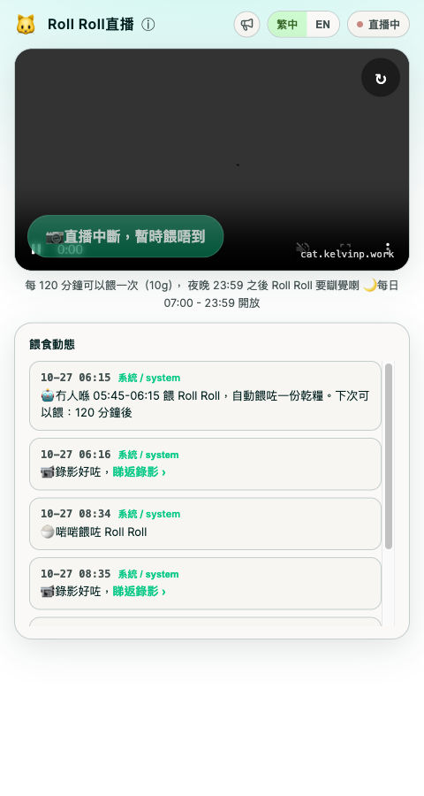
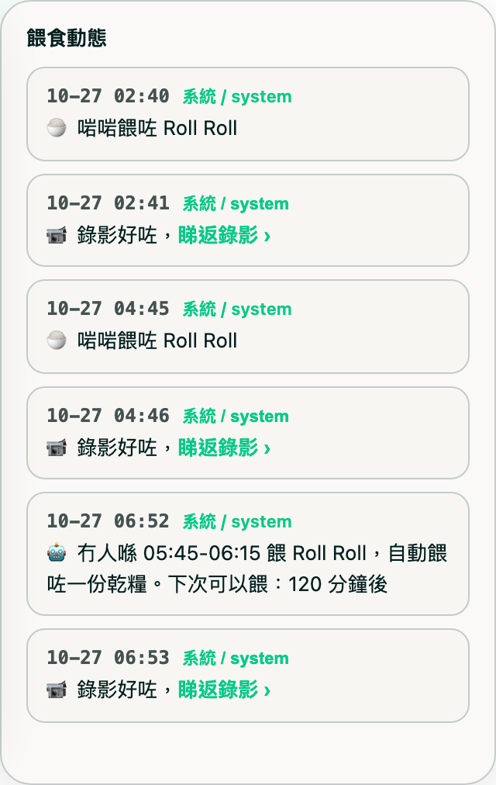

# 🐱 CatCam

A public **"feed my cat"** web app. Viewers open a link, watch a live stream of
the cat, and press a button to dispense a portion of food — subject to sensible
rules (shared cooldown, open hours, anti-spam). The button ultimately triggers a
real smart feeder through Home Assistant. A hidden admin channel (tap the logo
5×) lets the owner bypass those rules with an HMAC-signed request.

```
Viewer's browser
      │
      ├────────────────────────────────────────────┐
      ▼                                             ▼
SvelteKit frontend  ──►  FastAPI backend  ──►  Home Assistant REST API  ──►  🍚 feeder
   (static SPA)          (rules + state)        (text.*_manual_feed)
      │
      ▼
go2rtc (WebSocket + MSE)  ──►  Home Assistant WHEP  ──►  📷 PetKit camera
```

## Why I built it

I wanted a small but complete full-stack project on real hardware: a camera and
a smart pet feeder at home, exposed safely to the public internet. It turned
into a nice exercise in API design, concurrency, rate limiting, and keeping
secrets on the server side — never in the browser.

## Repository layout

| Folder             | What it is                                                        |
| ------------------ | ----------------------------------------------------------------- |
| [`catcam-backend`](./catcam-backend)   | Python + FastAPI service. Enforces feeding rules and calls Home Assistant. Keeps the HA token server-side. |
| [`catcam-frontend`](./catcam-frontend) | SvelteKit static SPA (繁中/EN toggle). Live stream (go2rtc, WebSocket+MSE), status, feed button, and a hidden admin channel. |

Each folder has its own README with setup and deployment details.

## Feeding rules

- **Link-only** — no login required.
- **Shared cooldown** — 120 minutes between feeds, across all visitors.
- **Open hours** — 07:00–23:59 (Asia/Hong_Kong).
- **Fixed portion** — one standard amount per feed.
- **Per-IP anti-spam** — stops a single client hammering the endpoint (separate from the feeding quota).
- State (`last_fed_at`) is persisted in **SQLite**, so restarts keep the limits.

## Screenshots

The feed button reflects exactly one state at a time — `GET /status` returns
`can_feed` + a `reason`, and the frontend renders accordingly:

| State | `reason` | What the visitor sees |
| ----- | -------- | ---------------------- |
| Ready to feed | `ok` |  |
| Cooldown running | `cooldown` |  |
| Outside open hours | `outside_hours` |  |
| Feeder (Home Assistant) unreachable | `ha_offline` |  |
| Live stream stalled | `stream_offline` |  |
| Admin paused feeding ("fasting mode") | `fasting` | Feed button disabled; a themed banner overlays the live view. Highest-priority reason — overrides `ha_offline`/`stream_offline` even if both are also true, since it's a deliberate choice rather than an outage. |

`ha_offline` is detected server-side by a background poll against Home
Assistant (independent of any feed attempt) — the button disables itself
within ~15s of HA going down, instead of waiting for a visitor to hit it and
get a 502.

All screenshots above except `stream_offline` show a live camera frame —
captured with
[`docs/screenshots/camera-live-reference.png`](docs/screenshots/camera-live-reference.png)
kept as the canonical "online" reference frame, so any future re-capture of
these screenshots reuses the same scene instead of whatever happens to be in
frame at capture time. `stream_offline` is the one state where there's no
frame to show by definition — the screenshot captures the feeder mid-outage.

Beside the live view (below it on mobile) is a read-only **feeding activity**
feed. Every real dispense — from the site, the PetKit app, the physical
button, or a scheduled auto-feed — posts two messages about a minute apart:
"🍚 餵咗 Roll Roll" the instant it's detected, then "📹 錄影好咗" with a
watch-back link once the 60-second clip finishes rendering.



The hidden admin channel (tap the logo 5×, enter the password) unlocks a
force-feed button that bypasses all the rules above, a simulate-visitor test
feed for exercising the dispense pipeline without affecting the public
cooldown or stats, an announcement banner, auto-feed safety-net windows
(auto-feed a portion when a window closes if no one fed during it), and today's
PetKit-side dispense history:


**Fasting mode** (same admin panel) is a toggle, not just a UI skin — turning
it on also **pauses the auto-feed safety-net windows**. Those windows
dispense on their own (`autofeed.py`'s loop calls Home Assistant directly,
with no public request involved), so without this check they'd quietly
override the whole point of pausing feeding. The check is a plain early
`return` at the top of `_check_once()`, and deliberately leaves that cycle's
windows unmarked (not "handled") — clearing fasting while still inside the
auto-feed grace period lets the very next tick catch up and feed normally,
instead of silently skipping it for the day.

Fasting mode does **not** touch the shared cooldown — `last_fed_at` and the
`fasting` flag are two independent pieces of state. Starting a fast mid-
cooldown doesn't reset or extend the timer, and clearing it doesn't grant an
immediate feed if cooldown hasn't actually elapsed; `/status` just reports
whatever `reason` the cooldown math already produces once `fasting` is back
to `false` (`ok` if cooldown finished during the fast, `cooldown` with
however much time is actually left if it hadn't).

## Camera streaming (and why it goes through the cloud)

The camera here is a **PetKit YumShare Solo** — a smart feeder with a built-in
camera, not a normal IP camera. It has **no native RTSP or ONVIF output**, so
there is no `rtsp://…` URL to pull from directly the way you would with a
generic IP cam. PetKit delivers video over its own proprietary cloud protocol,
and the only supported path into Home Assistant is a cloud WHEP session.

That cloud hop is the weak link: on the **free tier (no "Care+" subscription)**
PetKit periodically tears down the camera session, which is the root cause of
the occasional "no live picture" outages (recovery is documented in the
`my-homelab` skill — reload the PetKit HA integration, then restart go2rtc).

```
How CatCam serves the feed today (half-cloud):

  YumShare Solo ──encrypted upload──► PetKit cloud ──WHEP──► HA ──► go2rtc ──► this site
                                       ▲
                            free tier (no Care+): this hop drops periodically —
                            the root cause of the "no live picture" outages
```

A fully-local, cloud-free path is *possible* but not built in — it needs a
community reverse-engineering project (e.g. `petkit-local` / LocalKit) that
re-provisions the device to a local stand-in server. That migration is tracked
as a separate project plan, not part of this repo.

Because those drops happen, the backend runs a **stream watchdog**. It judges
liveness off the 24/7 pre-roll buffer's segment freshness — not HA
reachability, since HA keeps reporting `streaming` right through a cloud stall.
When frames stop flowing it (a) sets `/status` `stream_online: false` so the
public feed button disables (`reason: stream_offline`), and (b) after a
sustained outage auto-runs the same recovery a human would — reload the PetKit
integration, restart go2rtc — rate-limited so a genuine cloud outage isn't
hammered.

## Tech stack

- **Backend:** Python, FastAPI, Uvicorn, httpx, SQLite
- **Frontend:** SvelteKit (static adapter), Vite
- **Infra:** Caddy (static serving + reverse proxy), Cloudflare Tunnel, Home
  Assistant, go2rtc (WHEP → WebSocket+MSE relay for the live camera)

## Where it runs (platform & resources)

Both parts run **together in one unprivileged LXC container** on my home
Proxmox box — no Docker, no Kubernetes, just systemd services. The Intel iGPU's
render node is passed into the container so go2rtc can do **hardware (VAAPI)
H264 encoding** of the re-streamed feed; that's what keeps CPU low.

| | What I actually run | Measured idle usage |
| --- | --- | --- |
| Host | Proxmox VE 9.2, kernel 6.x | — |
| Container | Debian 13 (trixie) LXC | — |
| vCPU | 1 core | ~16% of it (peak is the VAAPI encode) |
| RAM | 4 GB (generous overkill) | ~250 MB |
| Swap | 512 MB | 0 |
| Disk | 8 GB volume | ~2.8 GB (OS + venv + 7-day clips) |
| GPU | `/dev/dri/renderD128` passed in (VAAPI) | — |

### Recommended minimum

The 4 GB RAM is wildly more than needed — this comfortably fits a small box.
A realistic floor:

| Resource | Minimum | Notes |
| --- | --- | --- |
| **CPU** | **1 vCPU *with* hardware video encode** (VAAPI/an iGPU render node) | The one real cost is encoding the live re-stream. With VAAPI it's ~15% of a core. **Without** hardware encode, software H264 will peg a single core — then budget **2+ vCPU**. |
| **RAM** | **512 MB** (1 GB comfortable) | Measured footprint is ~250 MB; the rest is headroom + page cache. |
| **Disk** | **~4 GB** | OS + Python venv + the SvelteKit build + a rolling 7-day window of 60s clips (grows with how often the cat is fed). |
| **OS** | Any systemd Linux | No Docker required; it's plain `systemd` units. |
| **Network** | Outbound to Home Assistant + the feeder's cloud; a reverse proxy or tunnel (Caddy + Cloudflare Tunnel here) to expose it publicly | WebRTC media never needs to be exposed — only HTTPS/WSS. |

In short: **1 core + 512 MB–1 GB RAM + a few GB disk + an iGPU for VAAPI** is
plenty. The camera and feeder themselves (a PetKit YumShare Solo) and a Home
Assistant instance are the other prerequisites.

## Quick start

Run the two parts separately during development:

```bash
# Backend — see catcam-backend/README.md
cd catcam-backend
python3 -m venv .venv && .venv/bin/pip install -r requirements.txt
cp .env.example .env        # then set HA_TOKEN
.venv/bin/uvicorn app.main:app --host 127.0.0.1 --port 8080

# Frontend — see catcam-frontend/README.md
cd catcam-frontend
cp .env.example .env
npm install
npm run dev                 # http://localhost:5173
```

## Configuration & secrets

Both parts are configured via `.env` files. A `.env.example` template is
provided in each folder — copy it to `.env` and fill in your own values. The
real `.env` files are **git-ignored and never committed**; in particular the
Home Assistant long-lived access token lives only in the backend's `.env`.

